# Gaming Matchmaking Guides & Tips

Expert insights on finding teammates, building communities, and mastering competitive gaming

[FeaturedMatchmaking & AI October 28, 2025Updated on November 26, 2026AI Gaming Matchmaking: The Complete Guide for 2026How AI gaming matchmaking finds teammates by skill, playstyle, schedule, and personality—plus its history, privacy rules, and a practical checklist to build a squad that lasts. Jynx Team16 min read](/blog/ai-gaming-matchmaking-guide.html)

[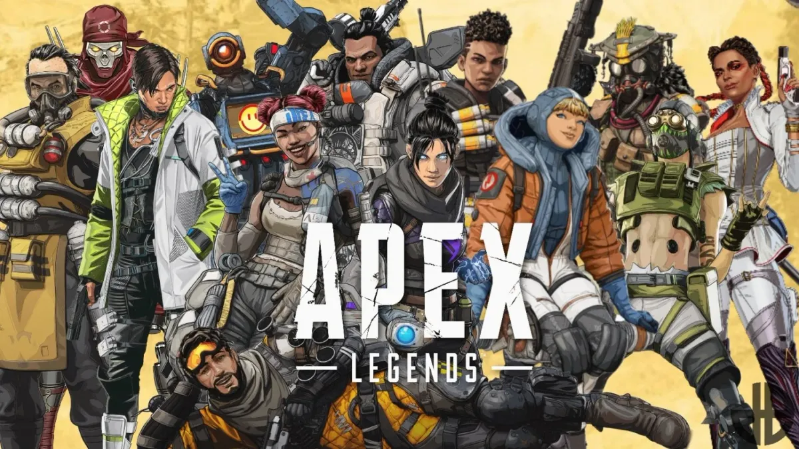Matchmaking & AI October 28, 2025Updated on November 26, 2026Finding Apex Legends Teammates Who Match Your PlaystyleHow to find Apex Legends teammates who match your playstyle — the five compatibility axes, building chemistry on purpose, and a trial process that filters bad fits before your RP does. Jynx Team13 min read](/blog/apex-legends-playstyle-matching.html)

[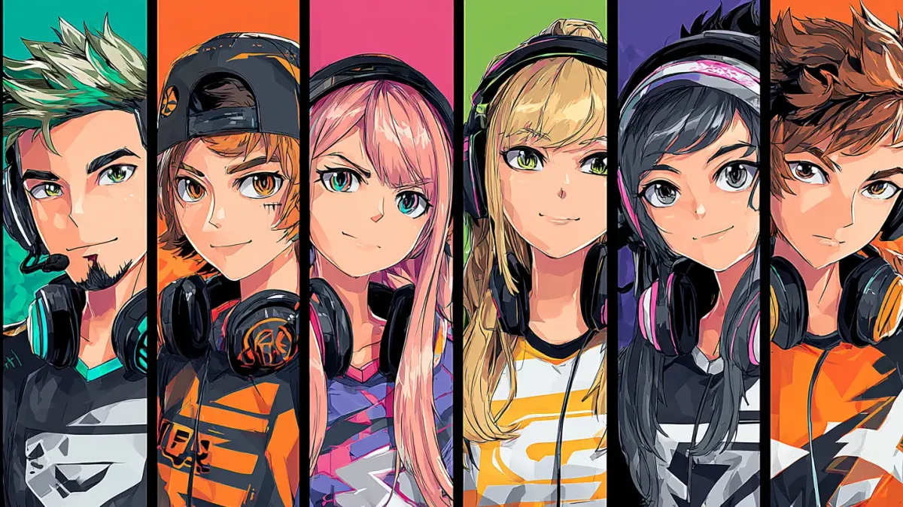FeaturedGaming Communities October 28, 2025Updated on November 26, 2026Building Gaming Communities That Last: The Field GuideWhy most gaming communities fold within six months, and the leadership, moderation, onboarding and inclusion systems the survivors use to keep members engaged for years. Jynx Team11 min read](/blog/building-lasting-gaming-communities.html)

[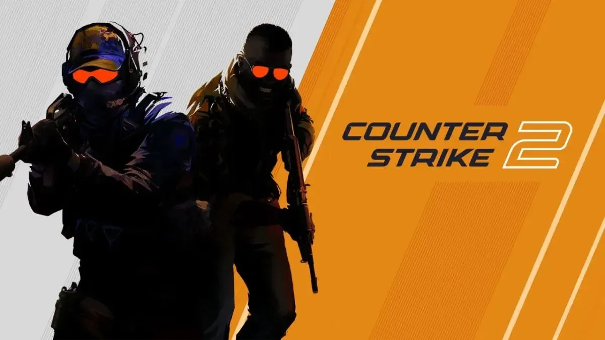Matchmaking & AI October 28, 2025Updated on November 26, 2026CS2 Team Roles Explained: How to Build a Balanced SquadEntry fragger, support, AWPer, IGL, lurker — what each CS2 role owns, how to combine them into a balanced squad, and how to find teammates who actually fill the gaps in your roster. Jynx Team13 min read](/blog/cs2-team-roles-guide.html)

[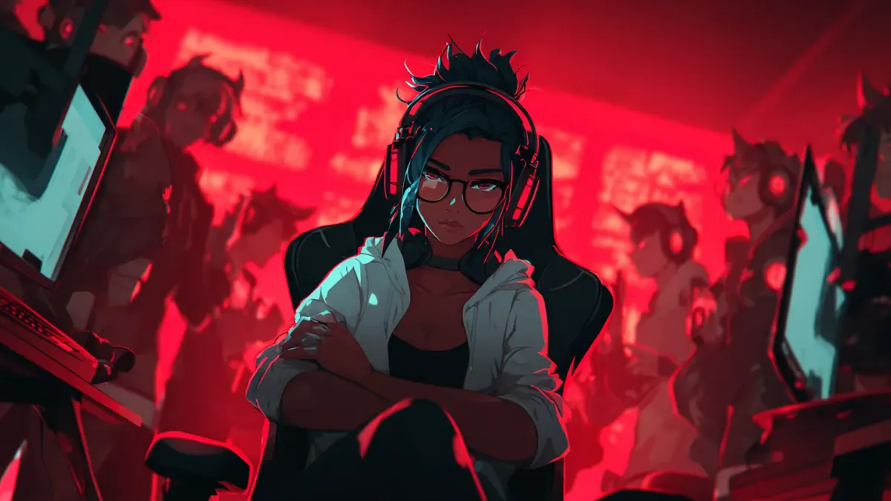Gaming Communities October 28, 2025Updated on November 26, 2026Managing Gaming Community Drama: A Leader's GuideA practical playbook for gaming community leaders: spot drama while it is still a spark, run the first 30 minutes of a live conflict, and moderate without splitting the group. Jynx Team12 min read](/blog/gaming-community-drama-management.html)

[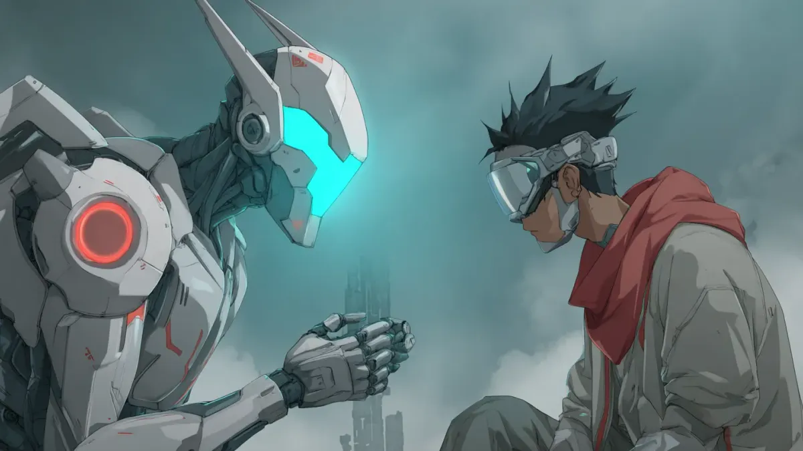Matchmaking & AI October 28, 2025Updated on November 26, 2026Gaming Matchmaking Algorithms: How They Really WorkHow gaming matchmaking algorithms actually work, from ELO and MMR ratings to team balancing, and what skill versus personality matching predicts about your teammates. Jynx Team10 min read](/blog/gaming-matchmaking-algorithms-explained.html)

[Social Gaming October 28, 2025Updated on November 26, 2026The Psychology Behind Perfect Gaming Team ChemistryThe psychology of gaming team chemistry: personality balance, communication fit, trust-building, group size, and the warning signs of a squad that will never click. Jynx Team11 min read](/blog/gaming-team-chemistry-psychology.html)

[Social Gaming October 28, 2025Updated on November 26, 2026Halo: Campaign Evolved Co-op: Build Your 2026 FireteamHalo arrives on PlayStation for the first time with 4-player online co-op. How the campaign plays with a squad, and how to find three players you can trust on Legendary. Jynx Team10 min read](/blog/halo-campaign-evolved-coop-guide-2026.html)

[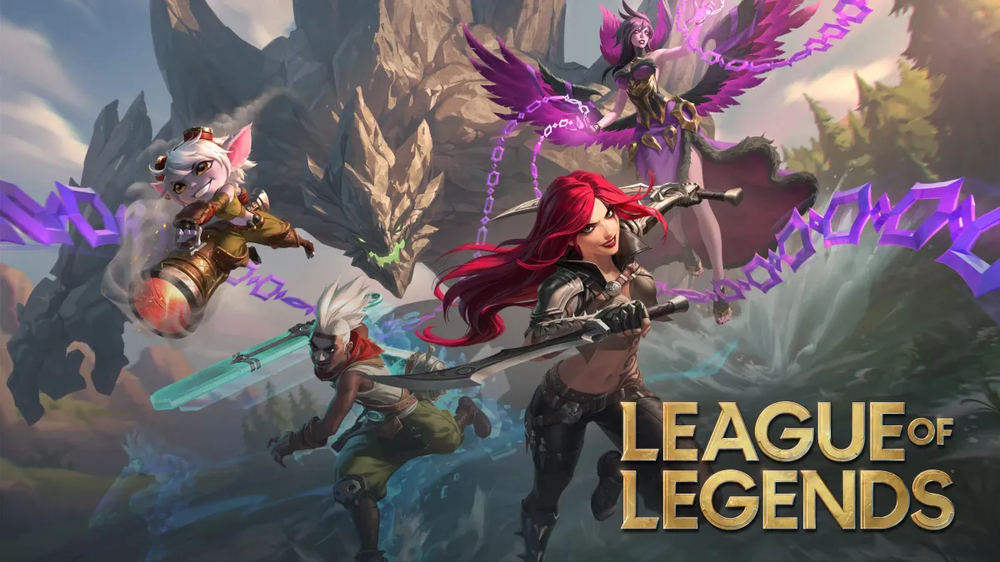Matchmaking & AI October 28, 2025Updated on November 26, 2026Best Duo Queue Champions in League: Synergy PatternsWhich champions actually synergize in League duo queue: bot lane combos, jungle-mid pairings, power-spike coordination, and the patterns that make duos win. Jynx Team9 min read](/blog/league-duo-queue-champions.html)

[FeaturedMatchmaking & AI October 28, 2025Updated on November 26, 2026The Complete Guide to Finding League of Legends TeammatesMaster the art of finding compatible League of Legends teammates who match your playstyle, rank, and communication preferences for consistent climbing success. Jynx Team13 min read](/blog/league-of-legends-teammate-guide.html)

[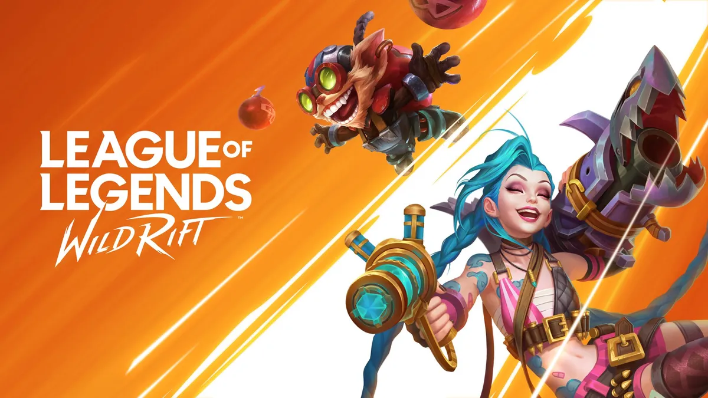Matchmaking & AI October 28, 2025Updated on November 26, 2026Mobile MOBA Matchmaking: Wild Rift vs Mobile LegendsHow Wild Rift and Mobile Legends matchmaking actually differ: rank ladders, hidden MMR, role queue, draft phases, and which game fits how you play. Jynx Team10 min read](/blog/mobile-moba-matchmaking-comparison.html)

[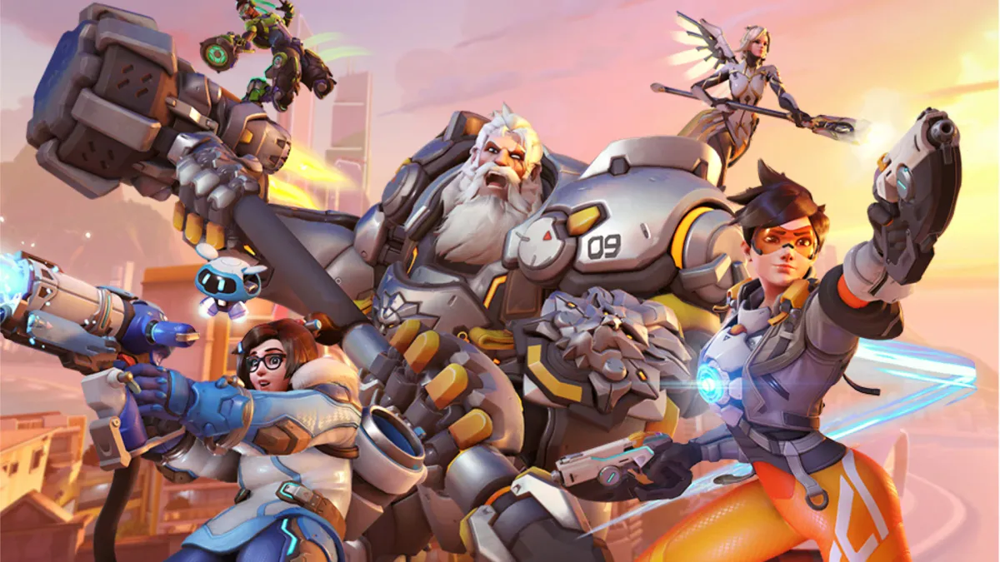Matchmaking & AI October 28, 2025Updated on November 26, 2026Overwatch 2 Team Synergies: Tank-Support CombinationsTank-support combinations that hold in any Overwatch 2 patch: composition families, ultimate economy, counter-swaps, and why a stacked five-stack still goes on losing streaks. Jynx Team12 min read](/blog/overwatch-2-team-synergies.html)

[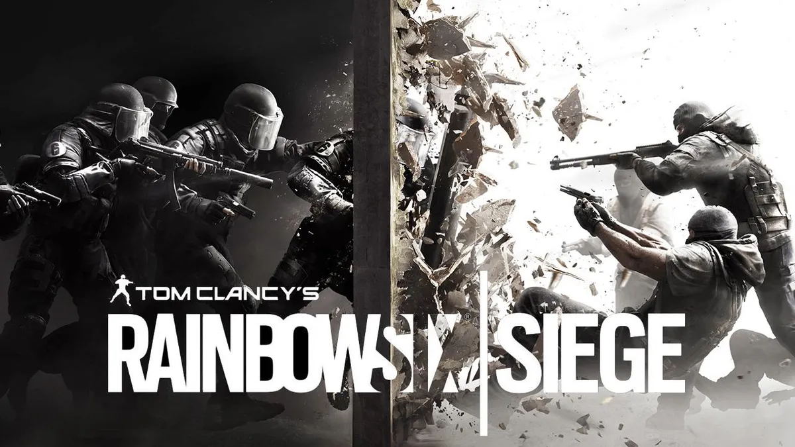Matchmaking & AI October 28, 2025Updated on November 26, 2026Rainbow Six Siege Team Building: From Duo to Five-StackHow to build a Rainbow Six Siege stack that actually wins: pick complementary roles, expand from duo to five without dead weight, and run callouts, drone economy and comms discipline like a real roster. Jynx Team12 min read](/blog/rainbow-six-siege-team-building.html)

[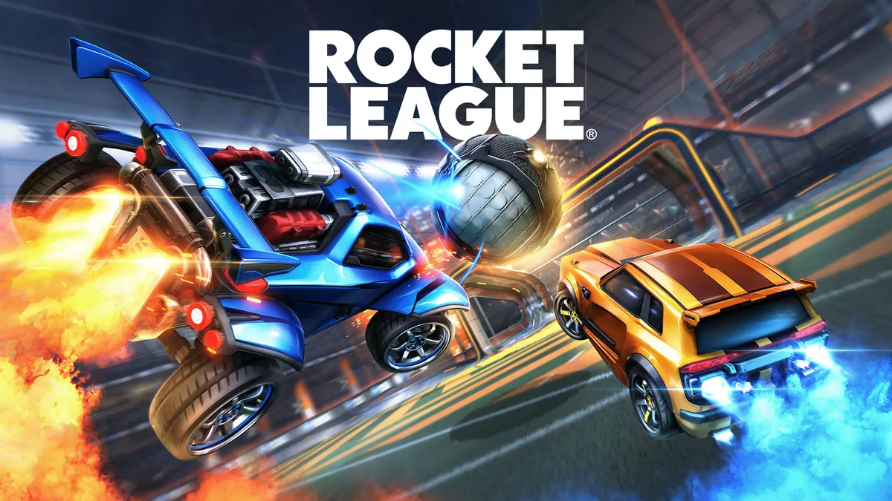Social Gaming October 28, 2025Updated on November 26, 2026Rocket League Team Chemistry vs Raw Mechanical SkillWhy coordinated Rocket League teams with average mechanics beat solo-queue stars, and how to find a 2v2 partner whose rotation, boost and comms habits match yours. Jynx Team9 min read](/blog/rocket-league-chemistry-vs-skill.html)

[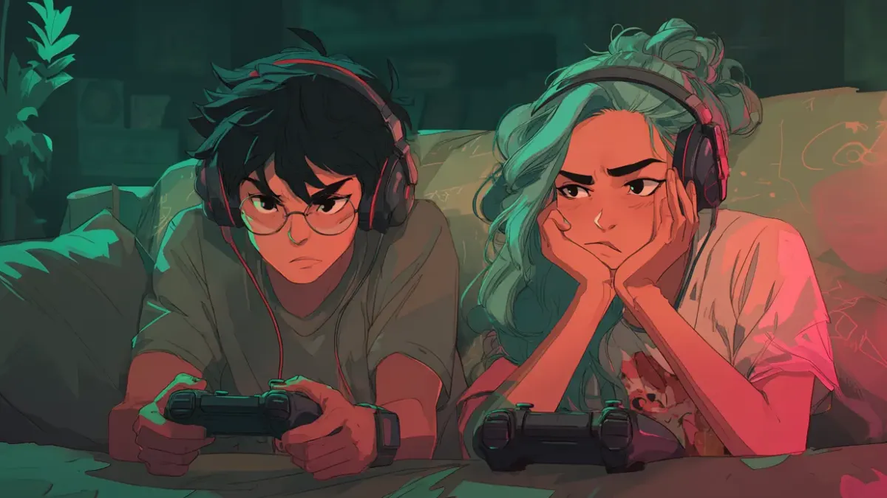Gaming Communities October 28, 2025Updated on November 26, 2026Toxic Gaming Teammates: The Hidden Cost to Your RankToxic teammates cost more than rank points. The real price of gaming toxicity: degraded performance, stalled improvement, wasted prime hours, and friendships that never form. Jynx Team8 min read](/blog/toxic-teammates-hidden-cost.html)

[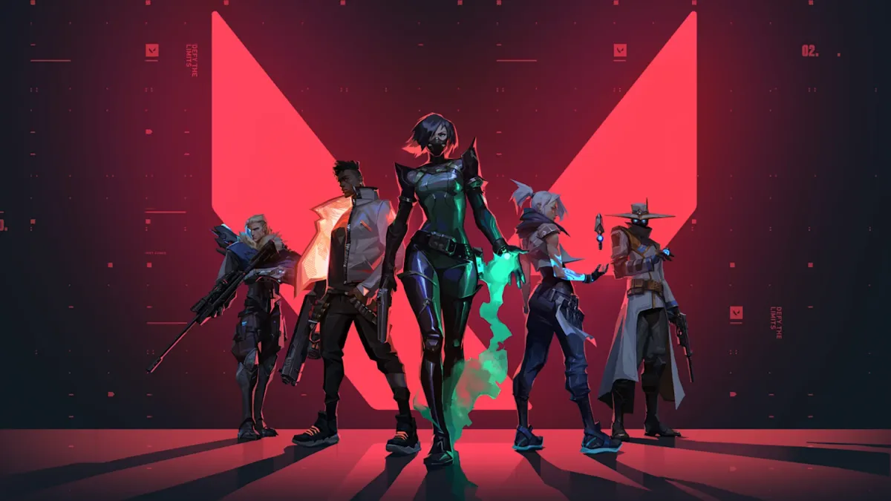Gaming Communities October 28, 2025Updated on November 26, 2026From Solo Queue to 5-Stack: Valorant Team ProgressionThe full path from Valorant solo queue to a coordinated 5-stack: finding a duo, expanding to trio and full roster, role balance, callouts, IGL structure, and the chemistry work that keeps a team alive. Jynx Team13 min read](/blog/valorant-solo-to-team.html)

[Gaming Communities October 28, 2025Updated on November 26, 2026Discord vs Reddit vs Forums: Where to Find Gaming TeamsWhere to find gaming teams, fast: how to run LFG on Discord, Reddit, and forums, what cross-play changes, and which route fits your goal tonight. Jynx Team10 min read](/blog/where-to-find-gaming-teams.html)

Page 1 of 1
