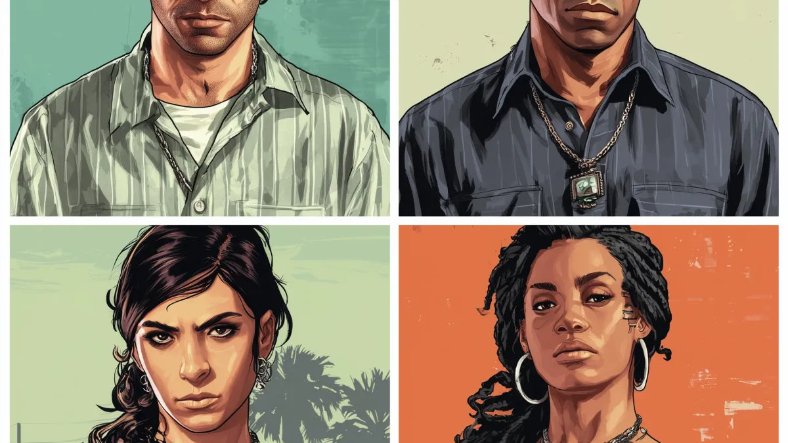
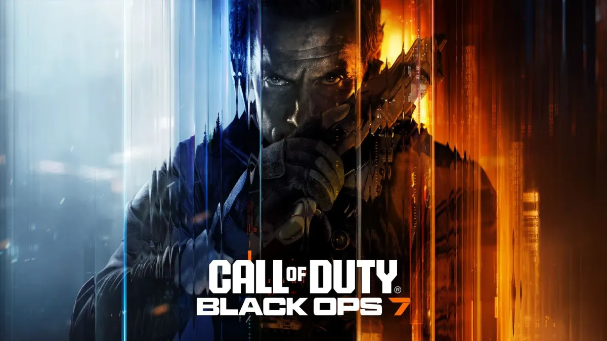
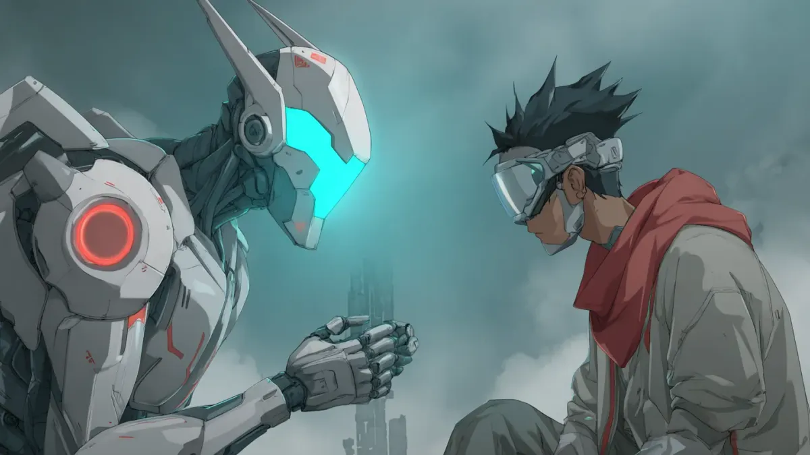
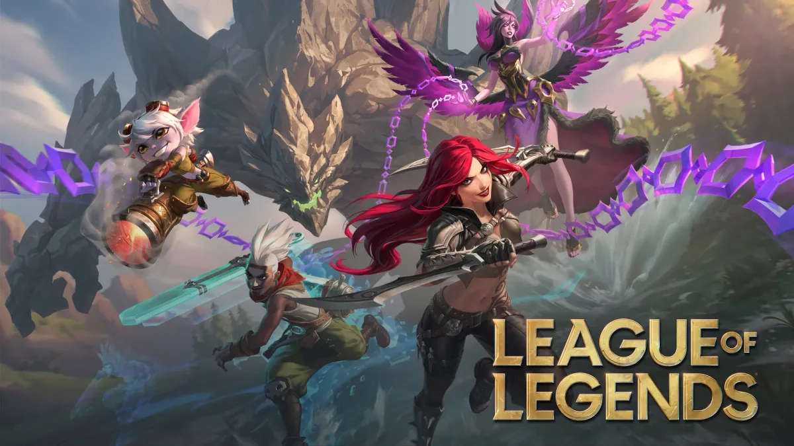
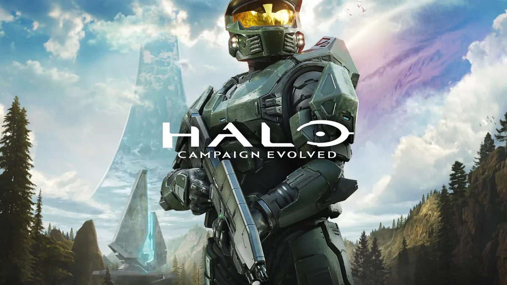
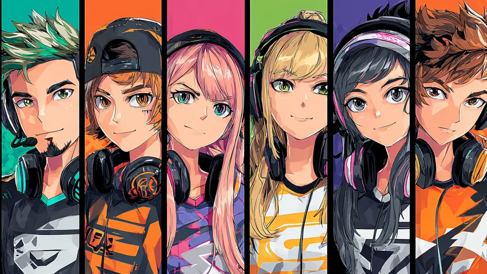

# Guides et Conseils Matchmaking Gaming

Conseils d'experts pour trouver des coéquipiers, construire des communautés et maîtriser le gaming compétitif

[Communautés Gaming 29 octobre 2025Guide Ultime Équipe GTA 6 Online Vice City Novembre 2026GTA 6 sort le 19 novembre 2026 — plus que six semaines. Constituez votre équipe maintenant : dénicher des coéquipiers, rôles de braquage et checklist de préparation au lancement pour Vice City. Jynx Team21 min de lecture](/fr/blog/guide-equipe-gta-6-online-vice-city-2026.html)

[À la UneCommunautés Gaming 28 octobre 2025Construire des Communautés Gaming Qui Durent VraimentLa plupart des communautés gaming s'effondrent en quelques mois. Découvrez les frameworks et stratégies éprouvés pour bâtir une communauté de jeux francophone durable, avec Discord, événements réguliers et vraie vie de groupe. Jynx Team29 min de lecture](/fr/blog/construire-communautes-gaming-durables.html)

[Communautés Gaming 28 octobre 2025Guide Escouade Black Ops 7 Zombies pour High RoundsAshes of the Damned est la plus grande carte zombies de COD jamais créée. Apprenez à constituer l'escouade parfaite de 4 joueurs pour survivre aux high rounds, éviter les coéquipiers toxiques et dominer le Dark Aether de Black Ops 7. Jynx Team13 min de lecture](/fr/blog/guide-escouade-zombies-black-ops-7.html)

[À la UneMatchmaking et IA 28 octobre 2025Le Guide Complet du Matchmaking Gaming Alimenté par l'IADécouvrez comment le matchmaking alimenté par l'IA aide les joueurs à trouver des coéquipiers parfaits en fonction de leurs compétences, leur style de jeu et leur personnalité. Guide complet avec conseils, outils et stratégies. Jynx Team17 min de lecture](/fr/blog/guide-matchmaking-ia-jeux.html)

[À la UneMatchmaking et IA 28 octobre 2025Trouver un Duo LoL : le Guide Complet des CoéquipiersMaîtrisez l'art de trouver un duo LoL et des coéquipiers compatibles avec votre style de jeu, votre elo et vos horaires pour monter en ranked de façon constante, sans solo queue à l'aveugle. Jynx Team28 min de lecture](/fr/blog/guide-trouver-duo-lol.html)

[Gaming Social 28 octobre 2025Halo Campaign Evolved Co-op: Ton Équipe Parfaite 2026Halo débarque sur PlayStation pour la première fois avec un mode coopératif à 4 joueurs. Voici tout ce que tu dois savoir pour trouver l'équipe parfaite pour les runs en difficulté Légendaire. Jynx Team13 min de lecture](/fr/blog/halo-campagne-evolved-guide-coop-2026.html)

[Communautés Gaming 28 octobre 2025Discord, Reddit ou Forums : Où Trouver des JoueursDécouvrez quelle plateforme donne les meilleurs résultats pour trouver des joueurs compatibles. Comparatif Discord, Reddit et forums avec taux de réussite réels et stratégies actionnables pour la scène francophone. Jynx Team15 min de lecture](/fr/blog/ou-trouver-des-joueurs.html)

[Communautés Gaming 28 octobre 2025Pourquoi les Petits Groupes Battent les Gros ClansDécouvrez pourquoi les petits groupes gaming de 8 à 15 joueurs battent régulièrement les clans de 100+ membres en coordination, fidélité et succès durable. La science derrière la taille optimale d'équipe. Jynx Team12 min de lecture](/fr/blog/petits-groupes-vs-clans.html)

Page 1 of 1

## Guides pratiques

- [LFG : que veut dire LFG dans les jeux vidéo ?](/fr/blog/glossaire/) LFG signifie Looking For Group. Définition, origine, abréviations liées (LFM, LFT) et comment poster une annonce LFG efficace pour trouver des joueurs.
- [Trouver des joueurs adultes (30 ans et plus) pour jouer sans prise de tête](/fr/blog/communaute/joueurs-adultes/) Comment trouver des joueurs adultes et sans prise de tête pour jouer le soir ? Critères, communautés et réflexes pour éviter les lobbies toxiques.
- [Comment éviter les joueurs toxiques en ranked](/fr/blog/communaute/joueurs-toxiques/) Mute, signalement, choix du mode et du partenaire : 6 réflexes pour éviter les joueurs toxiques en ranked et protéger votre rang comme votre moral.
- [MMR, Elo, SBMM et duo queue : le matchmaking compétitif expliqué](/fr/blog/guides-ranked/matchmaking-competitif/) MMR, Elo, LP, rang visible : quelle différence ? Guide clair du matchmaking compétitif avec exemples sur League of Legends, Valorant et Counter-Strike 2.
- [Trouver des mates sérieux pour grimper en ranked](/fr/blog/guides-ranked/mates-serieux-ranked/) Comment trouver des mates sérieux pour grimper en ranked ? 5 critères pour choisir un partenaire de duo ou d'équipe qui fait vraiment progresser.
- [Jouer avec des gens qui ont les mêmes horaires que vous](/fr/blog/communaute/memes-horaires/) Comment trouver des coéquipiers qui jouent aux mêmes heures que vous ? Méthode en 5 étapes et applis qui croisent les disponibilités avant de se contacter.
- [Pourquoi votre rang ne monte pas en solo (et comment y remédier)](/fr/blog/guides-ranked/monter-en-ranked-solo/) Vous stagnez en ranked en solo ? 5 vraies raisons (SBMM, tilt, mauvaise pratique, taux de victoire) et une méthode pour reprendre la progression.
- [Le SBMM, c'est quoi et pourquoi ça vous agace ?](/fr/blog/guides-ranked/sbmm/) SBMM : définition, jeux concernés et raisons de la polémique. Comprenez comment le matchmaking par niveau fonctionne et ce qui vous aide vraiment à jouer.
