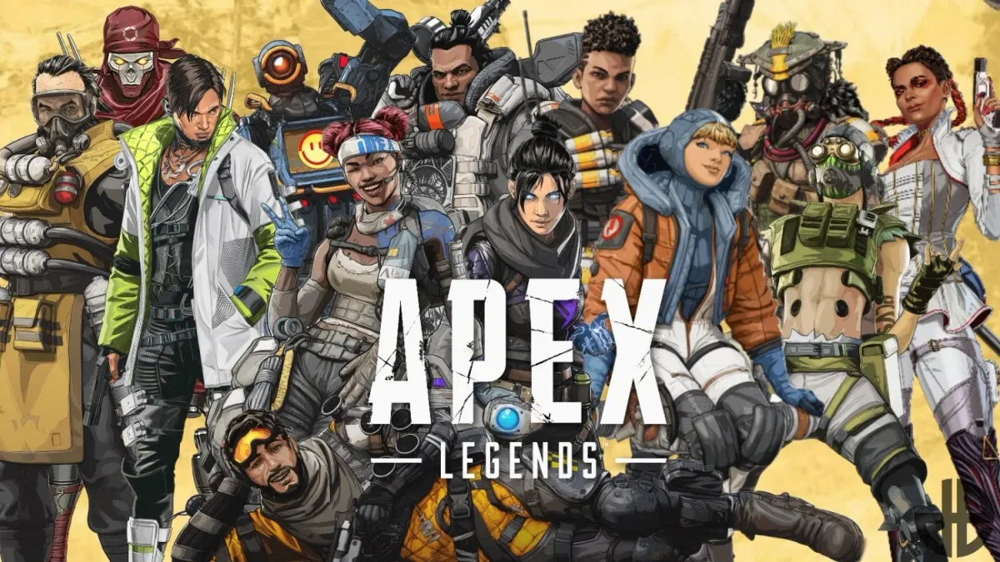

# Panduan & Tips Matchmaking Gaming

Wawasan ahli untuk menemukan rekan tim, membangun komunitas, dan menguasai gaming kompetitif

[Komunitas Gaming 29 Oktober 2025Panduan Crew GTA 6 Online Vice City November 2026 SempurnaGTA 6 rilis 19 November 2026. Bangun crew sempurna untuk lobby 96 pemain Vice City, heist lancar, kuasai open world masif dari hari pertama peluncuran. Jynx Team15 menit baca](/id/blog/panduan-membangun-tim-gta-6-online-vice-city-2026.html)

[Matchmaking & AI 28 Oktober 2025Bangkitnya Pelatih AI dalam Gaming KompetitifAlat analisis performa dan sistem optimasi strategi mengubah cara gamer kompetitif berlatih dan meningkatkan kemampuan mereka. Jynx Team17 menit baca](/id/blog/ai-coaches-competitive-gaming.html)

[Matchmaking & AI 28 Oktober 2025Menemukan Rekan Tim Apex Legends yang Cocok denganTemukan cara menemukan rekan tim Apex Legends yang melengkapi playstyle, preferensi legend, dan strategi rotasi Anda untuk kesuksesan ranked yang konsisten. Jynx Team11 menit baca](/id/blog/apex-legends-playstyle-matching.html)

[Gaming Sosial 28 Oktober 2025Halo: Campaign Evolved Co-op: Temukan Squad Sempurna untuk 2026Halo hadir di PlayStation untuk pertama kalinya dengan co-op 4 pemain. Berikut semua yang perlu kamu ketahui tentang menemukan squad sempurna untuk menaklukkan legendary. Jynx Team11 menit baca](/id/blog/panduan-coop-halo-campaign-evolved-2026.html)

[UnggulanMatchmaking & AI 28 Oktober 2025Panduan Lengkap Matchmaking Gaming Berbasis AITemukan bagaimana matchmaking berbasis AI membantu gamer menemukan rekan tim yang sempurna berdasarkan skill, playstyle, dan kepribadian. Panduan lengkap dengan tips, tools, dan strategi. Jynx Team14 menit baca](/id/blog/panduan-matchmaking-ai-game.html)

[Komunitas Gaming 28 Oktober 2025Panduan Tim Black Ops 7 Zombies untuk Round TinggiAshes of the Damned adalah map zombies COD terbesar sepanjang masa. Pelajari cara membangun tim 4 pemain yang sempurna untuk bertahan di round tinggi, menghindari rekan tim yang toxic, dan mendominasi Dark Aether di Black Ops 7. Jynx Team10 menit baca](/id/blog/panduan-tim-zombie-black-ops-7.html)

Page 1 of 1
