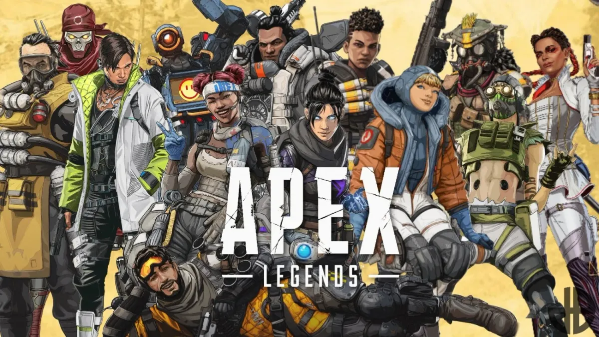

# Panduan & Tips Matchmaking Gaming

Wawasan ahli untuk menemukan rekan tim, membangun komunitas, dan menguasai gaming kompetitif

[Matchmaking & AI 28 Oktober 2025Menemukan Rekan Tim Apex Legends yang Cocok denganTemukan cara menemukan rekan tim Apex Legends yang melengkapi playstyle, preferensi legend, dan strategi rotasi Anda untuk kesuksesan ranked yang konsisten. Jynx Team11 menit baca](/id/blog/apex-legends-playstyle-matching.html)

[Gaming Sosial 28 Oktober 2025Halo: Campaign Evolved Co-op: Temukan Squad Sempurna untuk 2026Halo hadir di PlayStation untuk pertama kalinya dengan co-op 4 pemain. Berikut semua yang perlu kamu ketahui tentang menemukan squad sempurna untuk menaklukkan legendary. Jynx Team11 menit baca](/id/blog/panduan-coop-halo-campaign-evolved-2026.html)

[UnggulanMatchmaking & AI 28 Oktober 2025Panduan Lengkap Matchmaking Gaming Berbasis AITemukan bagaimana matchmaking berbasis AI membantu gamer menemukan rekan tim yang sempurna berdasarkan skill, playstyle, dan kepribadian. Panduan lengkap dengan tips, tools, dan strategi. Jynx Team14 menit baca](/id/blog/panduan-matchmaking-ai-game.html)

Page 1 of 1
