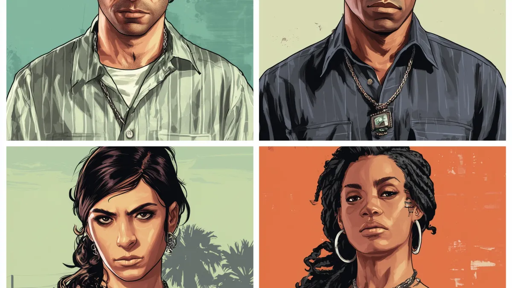
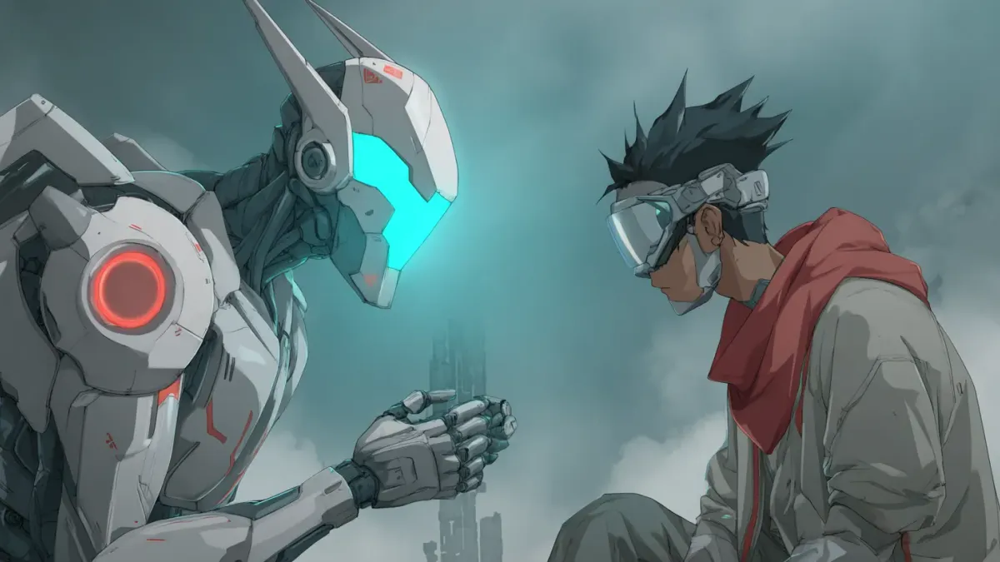
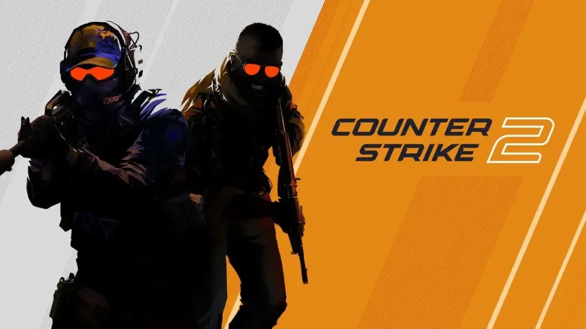
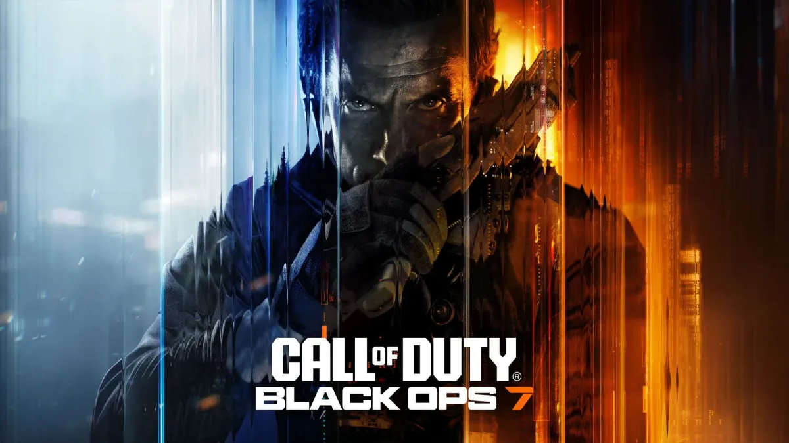
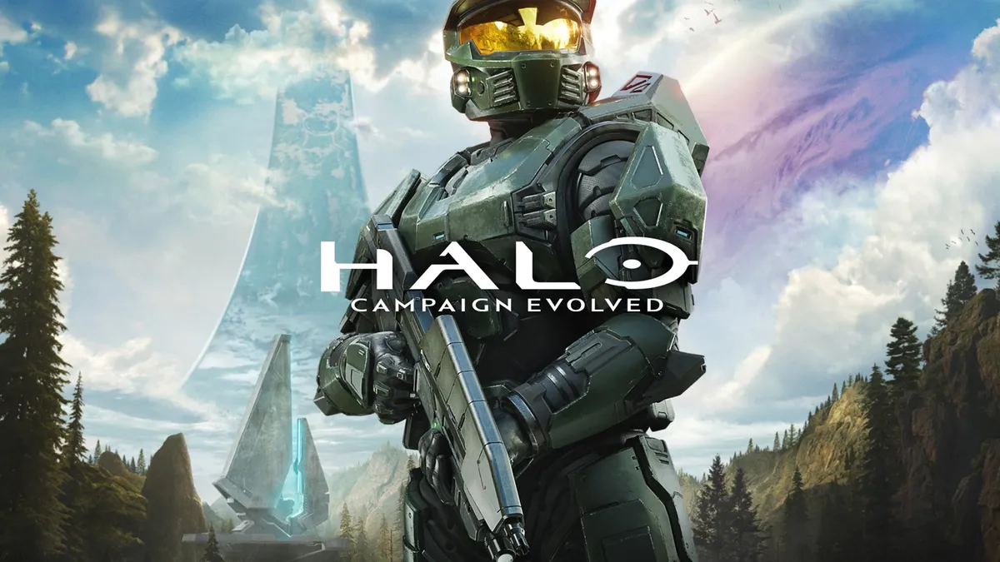
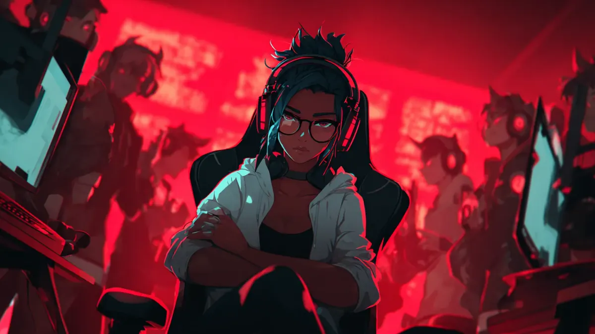

# Guide e Consigli sul Matchmaking Gaming

Approfondimenti esperti per trovare compagni, costruire comunità e padroneggiare il gaming competitivo

[In EvidenzaComunità Gaming 29 ottobre 2025Crew GTA 6 Vice City 2026: Guida Team BuildingGTA 6 arriva il 19 novembre 2026 con lobby a 96 giocatori. Scopri come costruire la crew perfetta, dominare le rapine e coordinare strategie vincenti a Vice City. Jynx Team16 min di lettura](/it/blog/guida-team-building-gta-6-online-vice-city-2026.html)

[Matchmaking e IA 28 ottobre 2025L'Ascesa degli AI Coach nel Gaming CompetitivoGli strumenti di analisi delle performance e i sistemi di ottimizzazione strategica stanno trasformando il modo in cui i gamer competitivi si allenano e migliorano le proprie abilità. Jynx Team20 min di lettura](/it/blog/ai-coaches-competitive-gaming.html)

[Comunità Gaming 28 ottobre 2025Trovare Compagni CS2 Non Tossici: Guida 2025Impara a identificare red flag e green flag quando cerchi compagni di Counter-Strike 2. Strategie di vetting provate e raccomandazioni della community per costruire squad senza tossicità. Jynx Team9 min di lettura](/it/blog/cs2-non-toxic-teammates.html)

[In EvidenzaMatchmaking e IA 28 ottobre 2025La Guida Completa al Matchmaking Gaming Basato su IAScopri come il matchmaking basato su IA aiuta i giocatori a trovare compagni di squadra perfetti in base a skill, stile di gioco e personalità. Guida completa con consigli, strumenti e strategie. Jynx Team15 min di lettura](/it/blog/guida-matchmaking-ia-gaming.html)

[Comunità Gaming 28 ottobre 2025Guida Squadra Black Ops 7 Zombies per Round AltiAshes of the Damned è la mappa zombi più grande di COD di sempre. Scopri come costruire la squadra perfetta a 4 giocatori per sopravvivere ai round alti, evitare compagni tossici e dominare il Dark Aether di Black Ops 7. Jynx Team12 min di lettura](/it/blog/guida-squadra-zombi-black-ops-7.html)

[Gaming Sociale 28 ottobre 2025Halo Campaign Evolved Co-op: La Tua Squadra Perfetta 2026Halo arriva su PlayStation per la prima volta in assoluto con co-op a 4 giocatori. Ecco tutto quello che devi sapere per trovare la squadra perfetta per le run leggendarie. Jynx Team12 min di lettura](/it/blog/halo-campaign-evolved-coop-guida-2026.html)

[Comunità Gaming 28 ottobre 2025Perché i Piccoli Gruppi Gaming Superano i Grandi ClanScopri perché i gruppi gaming intimi di 8-15 giocatori superano costantemente i clan di 100+ membri in coordinazione, lealtà e successo a lungo termine. La scienza dietro la dimensione ottimale del team. Jynx Team10 min di lettura](/it/blog/small-gaming-groups-vs-clans.html)

[Gaming Sociale 28 ottobre 20255 Segni Che Stai Giocando con lo Squad GamingRiconosci le red flag che indicano che il tuo squad gaming ti sta trattenendo, dai breakdown di comunicazione agli obiettivi disallineati e comportamenti tossici. Jynx Team12 min di lettura](/it/blog/wrong-gaming-squad-signs.html)

Page 1 of 1
