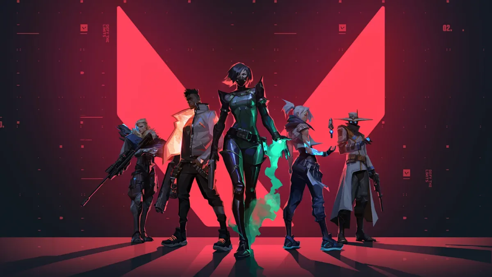
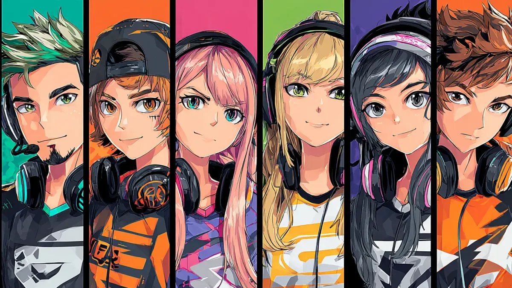
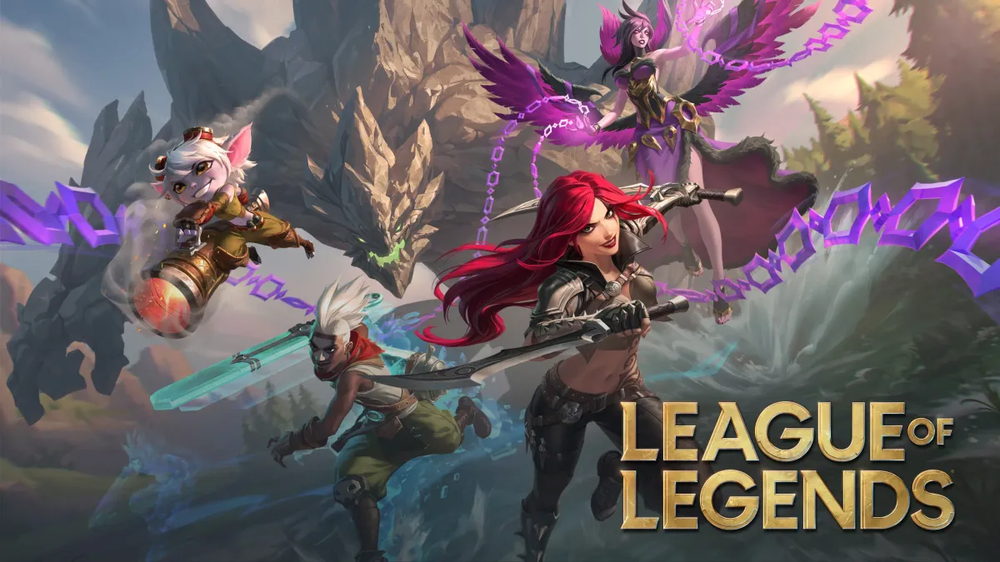

# Guias e Dicas de Matchmaking Gaming

Insights especializados para encontrar companheiros, construir comunidades e dominar gaming competitivo

[Comunidades de Jogos 29 de outubro de 2025Como Montar Sua Crew Perfeita no GTA 6 Vice City 2026GTA 6 chega em 19 de novembro de 2026 — faltam seis semanas. Monte sua crew: companheiros, funções de assalto e um checklist de preparação para o lançamento. Jynx Team19 min de leitura](/pt/blog/guia-construcao-equipe-gta-6-online-vice-city-2026.html)

[Matchmaking e IA 28 de outubro de 2025A Ascensão dos Coaches de IA em Jogos CompetitivosFerramentas de análise de desempenho e sistemas de otimização de estratégia estão transformando a forma como jogadores competitivos treinam e melhoram suas habilidades. Jynx Team19 min de leitura](/pt/blog/ai-coaches-competitive-gaming.html)

[Comunidades de Jogos 28 de outubro de 2025De Solo Queue a 5-Stack: Como Entrar em um Time de ValorantDomine a jornada do caos do solo queue ao sucesso no 5-stack. Estratégias comprovadas para achar duo no Valorant, montar time, criar química e evoluir na ranqueada — do primeiro duo ao roster competitivo. Jynx Team15 min de leitura](/pt/blog/como-entrar-em-um-time-de-valorant.html)

[DestaqueComunidades de Jogos 28 de outubro de 2025Como Construir Comunidades de Jogos Que Duram de VerdadeA maioria das comunidades de gaming morre em poucos meses. Aprenda os frameworks e estratégias comprovados que ajudam líderes a construir comunidades de jogos prósperas, com Discord, grupo de zap e engajamento real. Jynx Team29 min de leitura](/pt/blog/construir-comunidades-de-jogos-duradouras.html)

[Comunidades de Jogos 28 de outubro de 2025Guia Esquadrão Black Ops 7 Zombies para High RoundsAshes of the Damned é o maior mapa de zumbis do COD de todos os tempos. Aprenda a montar o esquadrão de 4 jogadores perfeito para sobreviver em high rounds, evitar companheiros tóxicos e dominar o Dark Aether de Black Ops 7. Jynx Team12 min de leitura](/pt/blog/guia-esquadrao-zumbis-black-ops-7.html)

[DestaqueMatchmaking e IA 28 de outubro de 2025O Guia Completo para Matchmaking em Jogos com IADescubra como o matchmaking com IA ajuda gamers a encontrar companheiros de equipe perfeitos baseado em habilidade, estilo de jogo e personalidade. Guia completo com dicas, ferramentas e estratégias. Jynx Team16 min de leitura](/pt/blog/guia-matchmaking-ia-jogos.html)

[DestaqueMatchmaking e IA 28 de outubro de 2025Guia Completo para Achar Duo e Time no League of LegendsDomine a arte de achar duo no LoL e companheiros de time compatíveis com seu estilo de jogo, elo e horário. Guia completo de duo queue, Clash e subida de elo no League of Legends. Jynx Team24 min de leitura](/pt/blog/guia-procurar-duo-lol.html)

[Jogos Sociais 28 de outubro de 2025Halo Campaign Evolved Co-op: Seu Esquadrão Perfeito 2026Halo chega ao PlayStation pela primeira vez com co-op de 4 jogadores. Aqui está tudo que você precisa saber para encontrar o esquadrão perfeito para partidas lendárias. Jynx Team12 min de leitura](/pt/blog/halo-campanha-evoluida-guia-coop-2026.html)

[Comunidades de Jogos 28 de outubro de 2025Onde Achar Time para Jogar: Discord, Grupo de Zap ou App?Descubra qual plataforma entrega o melhor resultado para achar time para jogar no Brasil. Compare Discord, grupos de WhatsApp, Gamers Club e apps com taxas de sucesso e estratégias práticas. Jynx Team13 min de leitura](/pt/blog/onde-achar-time-para-jogar.html)

Page 1 of 1
