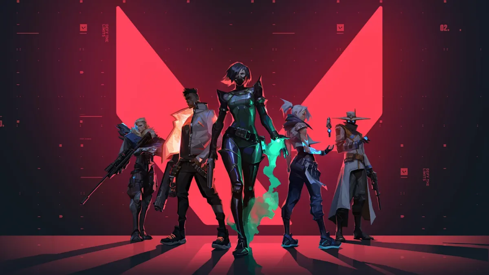
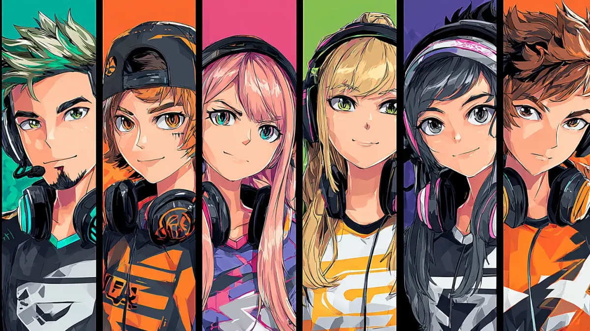
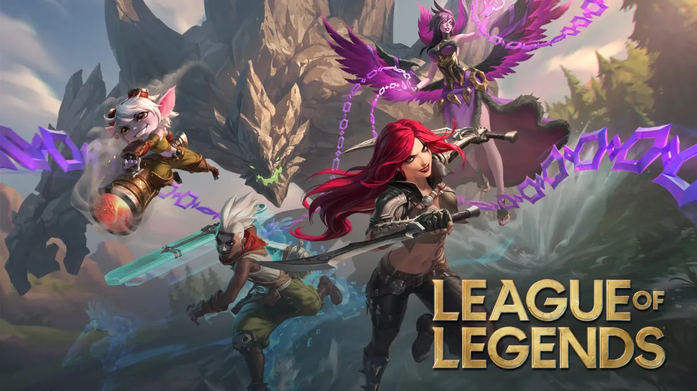

# Guias e Dicas de Matchmaking Gaming

Insights especializados para encontrar companheiros, construir comunidades e dominar gaming competitivo

[Comunidades de Jogos 28 de outubro de 2025Atualizado em 26 de novembro de 2026De Solo Queue a 5-Stack: Como Entrar em um Time de ValorantO caminho completo do solo queue do Valorant até um 5-stack coordenado: achar duo, expandir para trio e roster completo, balancear papéis, callouts, estrutura de IGL e o trabalho de química que mantém o time vivo. Jynx Team14 min de leitura](/pt/blog/como-entrar-em-um-time-de-valorant.html)

[DestaqueComunidades de Jogos 28 de outubro de 2025Atualizado em 26 de novembro de 2026Como Construir Comunidades de Jogos Que Duram: Guia PráticoPor que a maioria das comunidades de jogos morre em seis meses, e os sistemas de liderança, moderação, boas-vindas e inclusão que mantêm os sobreviventes com membros ativos por anos. Jynx Team13 min de leitura](/pt/blog/construir-comunidades-de-jogos-duradouras.html)

[DestaqueMatchmaking e IA 28 de outubro de 2025Atualizado em 26 de novembro de 2026Matchmaking com IA em Jogos: O Guia Completo para 2026Como o matchmaking com IA encontra companheiros por habilidade, estilo de jogo, horário e personalidade—mais a história do LFG, privacidade e um checklist prático para montar um squad que dura. Jynx Team18 min de leitura](/pt/blog/guia-matchmaking-ia-jogos.html)

[DestaqueMatchmaking e IA 28 de outubro de 2025Atualizado em 26 de novembro de 2026Guia Completo para Achar Duo e Time no League of LegendsDomine a arte de achar duo no LoL e companheiros de time compatíveis com seu estilo de jogo, elo e horário — e aprenda a testar, blindar contra tilt e manter a dupla viva na subida. Jynx Team14 min de leitura](/pt/blog/guia-procurar-duo-lol.html)

[Jogos Sociais 28 de outubro de 2025Atualizado em 26 de novembro de 2026Halo: Campaign Evolved Co-op: Monte Seu Fireteam 2026Halo chega ao PlayStation pela primeira vez com co-op online de 4 jogadores. Como a campanha funciona com squad, e como achar três players de confiança para o Legendary. Jynx Team11 min de leitura](/pt/blog/halo-campanha-evoluida-guia-coop-2026.html)

[Comunidades de Jogos 28 de outubro de 2025Atualizado em 26 de novembro de 2026Onde Achar Time para Jogar: Discord, Grupo de Zap ou App?Onde achar time para jogar, rápido: como rodar LFG no Discord, Reddit e fóruns, o que o crossplay muda e qual caminho resolve o seu objetivo hoje. Jynx Team11 min de leitura](/pt/blog/onde-achar-time-para-jogar.html)

Page 1 of 1
