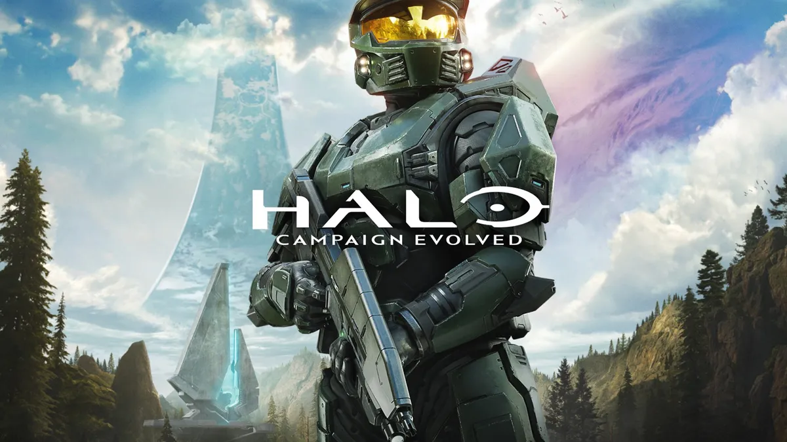

# Hướng Dẫn và Mẹo Ghép Đội Gaming

Thông tin chi tiết từ chuyên gia để tìm đồng đội, xây dựng cộng đồng và làm chủ gaming cạnh tranh

[Game Xã hội 28 tháng 10, 2025Cập nhật vào 24 tháng 11, 2026Halo: Campaign Evolved Co-op: Tìm Đội Hình Hoàn Hảo Năm 2026Halo lần đầu tiên ra mắt trên PlayStation với chế độ co-op 4 người chơi. Đây là tất cả những gì bạn cần biết về việc tìm đội hình hoàn hảo cho chế độ legendary. Jynx Team14 phút đọc](/vi/blog/huong-dan-choi-coop-halo-campaign-evolved-2026.html)

[Nổi BậtGhép cặp & AI 28 tháng 10, 2025Hướng Dẫn Hoàn Chỉnh Về Ghép Cặp Game Bằng AIKhám phá cách ghép cặp bằng AI giúp game thủ tìm đồng đội hoàn hảo dựa trên kỹ năng, phong cách chơi và tính cách. Hướng dẫn đầy đủ với mẹo, công cụ và chiến lược. Jynx Team19 phút đọc](/vi/blog/huong-dan-ghep-cap-game-ai.html)

Page 1 of 1
